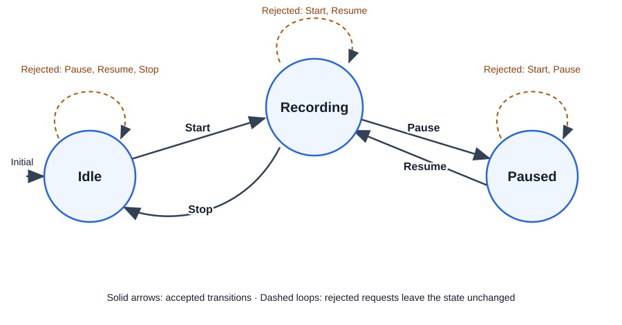

# 200000 - Recording with a switch

## Goal

Understand states, requests, and transitions before introducing the State design pattern. This original learning example models a recorder; it does not record audio or video.

A state describes what the recorder is doing. A request asks it to do something. An accepted request changes its state: that change is a transition.

## Rules

A recorder starts in `Idle`.

| Current state | Request | Next state |
|---|---|---|
| Idle | Start | Recording |
| Recording | Pause | Paused |
| Recording | Stop | Idle |
| Paused | Resume | Recording |
| Paused | Stop | Idle |

Every other request is rejected, leaving the state unchanged. `TryHandle` returns `true` for acceptance and `false` for rejection. Rejection is an expected outcome, and the console reports it explicitly. Callers can read the current state but cannot assign it. Each recorder owns its state independently.

## State graph

Solid arrows show accepted transitions. Dashed self-loops show requests that are rejected without changing the current state.



## Run

Requires the .NET 10 SDK or a compatible newer SDK. From this exercise directory:

```powershell
dotnet build .\RecordingWithSwitch.slnx
dotnet run --project .\RecordingWithSwitch\RecordingWithSwitch.csproj
```

Alternatively, open `RecordingWithSwitch.slnx` in Visual Studio and run the console project.

Expected output:

```text
Initial state: Idle
Idle + Pause -> Idle (Rejected)
Idle + Start -> Recording (Accepted)
Recording + Pause -> Paused (Accepted)
Paused + Resume -> Recording (Accepted)
Recording + Stop -> Idle (Accepted)
Idle + Start -> Recording (Accepted)
Recording + Pause -> Paused (Accepted)
Paused + Stop -> Idle (Accepted)
```

## Read the code

1. `RecordingState.cs`: the three possible states.
2. `RecordingRequest.cs`: the four possible requests.
3. `Recorder.cs`: the transition rules implemented with a switch. A `when` clause selects a case only when its request condition is satisfied.
4. `Program.cs`: a fixed sequence demonstrating all five allowed transitions and one rejected request.

This version intentionally has no state subclasses, XML, UI, asynchronous operations, or real recording dependencies. It is a baseline to compare with a later State-pattern implementation. A dedicated test project is the next step; the console demonstration is not a complete test suite.
