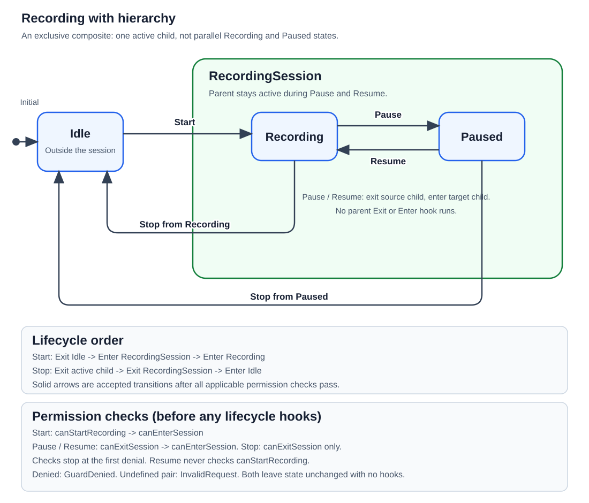

# 206000 - Recording with hierarchy

This self-contained .NET 10 exercise introduces an **exclusive composite state**: the top-level `RecordingSession` contains exactly one active child, `Recording` or `Paused`. It keeps the familiar Idle, Start, Pause, Resume, Stop, and transition-result concepts while adding parent lifecycle and permission behavior.

## State diagram



The green boundary is the parent composite. Pause and Resume stay inside it; Start enters it, and either Stop arrow leaves it. The panels below the graph show lifecycle order and permission checks. A denied or invalid request is not a self-transition: it leaves the active state unchanged and runs no lifecycle hooks.

[Open the SVG diagram](recording-state-graph.svg) to view it separately or zoom in.

## Hierarchy and lifecycle

```text
Recorder
├── Idle
└── RecordingSession (composite)
	├── Recording (one active child)
	└── Paused    (one active child)
```

| Request | Lifecycle order | Resulting active mode |
|---|---|---|
| Start from Idle | Exit Idle, Enter RecordingSession, Enter Recording | Recording |
| Pause | Exit Recording, Enter Paused | Paused |
| Resume | Exit Paused, Enter Recording | Recording |
| Stop from Recording | Exit Recording, Exit RecordingSession, Enter Idle | Idle |
| Stop from Paused | Exit Paused, Exit RecordingSession, Enter Idle | Idle |

Pause and Resume replace only the child. The `RecordingSession` parent stays active, so its lifecycle hooks do not run again. Stop leaves the composite and exits its active child before the parent. `CurrentState` exposes the active leaf mode; parent lifecycle events make composite entry and exit observable.

## Permission checks

The recorder has three policies with distinct scope:

- `canStartRecording` is a transition-specific guard for Start from Idle. Resume does not call it.
- `canEnterSession` is the parent composite's entry policy. It is checked when the composite is first entered and before a target child is entered during Pause or Resume.
- `canExitSession` is the parent composite's exit policy. It is checked before leaving the active child during Pause, Resume, or Stop.

Thus, an internal Pause/Resume can consult both parent permissions without running the parent's Enter or Exit hook. A denied policy returns `GuardDenied`, leaves the active child unchanged, and runs no lifecycle hooks. Invalid state/request pairs return `InvalidRequest`; accepted transitions return `Transitioned` after lifecycle work completes. Permission exceptions propagate rather than becoming result values.

This deliberately mirrors the delegation shape of ExecUI's child `CanEnter`/`CanExit` checks while keeping it small and explicit. It demonstrates that **permission checks and lifecycle hooks have different scopes**: parent permission can be consulted on a child transition even when the composite itself remains active.

## Design

- `RecordingSessionState` owns the exclusive active child and performs parent/child lifecycle ordering.
- `RecordingState` and `PausedState` implement child lifecycle hooks; they do not act as sibling parents.
- `IdleState` is outside the composite.
- `Recorder` validates requests, evaluates the Start guard and parent permissions, and coordinates top-level transitions.
- `TransitionResult` distinguishes successful transitions, invalid requests, and policy denial.

This is a single composite level with a single active child. It is **not** the same as ExecUI's `ParallelStateBase`, which can represent multiple active substates.

## Run

Open `RecordingWithHierarchy.slnx` in Visual Studio, or run these commands from this exercise directory:

```powershell
dotnet run --project .\RecordingWithHierarchy\RecordingWithHierarchy.csproj
dotnet test .\RecordingWithHierarchy.Tests\RecordingWithHierarchy.Tests.csproj
dotnet test .\RecordingWithHierarchy.slnx
```

Expected output:

```text
Enter Idle
Check Start permission
Check RecordingSession CanEnter
Exit Idle
Enter RecordingSession
Enter Recording
Start: Transitioned; state: Recording
Check RecordingSession CanExit
Check RecordingSession CanEnter
Exit Recording
Enter Paused
Pause: Transitioned; state: Paused
Check RecordingSession CanExit
Check RecordingSession CanEnter
Exit Paused
Enter Recording
Resume: Transitioned; state: Recording
Check RecordingSession CanExit
Stop while parent CanExit is false: GuardDenied; state: Recording
Check RecordingSession CanExit
Exit Recording
Exit RecordingSession
Enter Idle
Stop after parent CanExit is allowed: Transitioned; state: Idle
```

## Tests

The 30 deterministic MSTest cases verify the full lifecycle trace and mode observed during hooks, all accepted and invalid requests, unknown request values, Start and parent permission denial, parent checks on internal child changes, Resume's independence from the Start guard, permission re-evaluation, propagated permission exceptions, reentrancy rejection, null dependencies, and instance independence.

## Deliberate limits

The example is synchronous, single-threaded learning code. It does not implement parallel substates, arbitrary-depth hierarchies, history states, bubbling triggers, asynchronous guards, rollback, or a general state-machine framework. The permission callbacks are policy checks, not resource reservations; they do not make multi-threaded permission changes safe. Exceptions from callbacks propagate. Lifecycle operations are not rolled back if an entry or exit callback throws.
