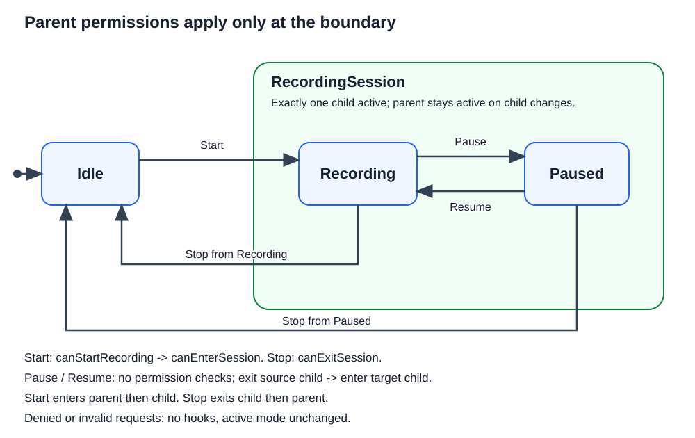

# 207000 - Recording with boundary permissions

This standalone .NET 10 exercise refines [206000's hierarchy](../206000_RecordingWithHierarchy/README.md) without changing that example. RecordingSession still contains exactly one active child, Recording or Paused. The change is **permission scope**, not hierarchy or lifecycle order.

## State diagram



## Permission and lifecycle rules

| Source | Request | Permission checks, in order | Lifecycle order | Target |
|---|---|---|---|---|
| Idle | Start | `canStartRecording`, `canEnterSession` | Exit Idle, Enter RecordingSession, Enter Recording | Recording |
| Recording | Pause | None | Exit Recording, Enter Paused | Paused |
| Paused | Resume | None | Exit Paused, Enter Recording | Recording |
| Recording | Stop | `canExitSession` | Exit Recording, Exit RecordingSession, Enter Idle | Idle |
| Paused | Stop | `canExitSession` | Exit Paused, Exit RecordingSession, Enter Idle | Idle |

Checks stop at the first denial. Denied boundary transitions return `GuardDenied` before lifecycle work; undefined state/request pairs return `InvalidRequest` without any checks or hooks. Accepted transitions return `Transitioned` after their hooks complete. Exceptions propagate rather than becoming result values.

**Pause and Resume do not cross the parent boundary.** They neither enter nor leave RecordingSession, so they call none of the three policies. They work even if all policies are false or would throw. Stop remains denied until exit permission is restored. If pausing or resuming requires domain permission, that should be a separate transition-specific guard, not an implicit reuse of parent-boundary policies.

### Compare with 206000

The earlier lesson deliberately checks parent permissions when changing children, resembling ExecUI's base-child delegation. This is a policy choice, not a requirement of hierarchy. Here `canEnterSession` means permission to enter the parent and `canExitSession` means permission to leave it. The parent lifecycle trace is identical in both lessons; only which policies run changes. See [section 19 of Discussion.md](../Discussion.md#19-parent-boundary-permissions) for the rationale.

## Implementation

- `Recorder` decides which requests cross the boundary and applies their checks before hooks.
- `RecordingSessionState` owns the active child and parent lifecycle. Its exit permission is used only for Stop; initial entry permission is checked by Recorder before allocation.
- Child states derive activity labels from `Mode` and have no parent policy calls.
- The session is created lazily after the first permitted Start. Observation, invalid requests, denied checks, and policy exceptions do not allocate it. Stop deactivates but retains the object; later Starts recheck policies and reuse it.
- Debugger displays show the recorder mode and the composite's active child and activation flag.

## Run

Open `RecordingWithBoundaryPermissions.slnx`, or run these commands from this exercise directory:

```powershell
dotnet run --project .\RecordingWithBoundaryPermissions\RecordingWithBoundaryPermissions.csproj
dotnet test .\RecordingWithBoundaryPermissions.Tests\RecordingWithBoundaryPermissions.Tests.csproj
dotnet test .\RecordingWithBoundaryPermissions.slnx
```

Expected output:

```text
Enter Idle
Check Start permission
Check RecordingSession CanEnter
Exit Idle
Enter RecordingSession
Enter Recording
Start: Transitioned; state: Recording
All permissions are now false.
Exit Recording
Enter Paused
Pause: Transitioned; state: Paused
Exit Paused
Enter Recording
Resume: Transitioned; state: Recording
Check RecordingSession CanExit
Stop: GuardDenied; state: Recording
Permissions restored.
Check RecordingSession CanExit
Exit Recording
Exit RecordingSession
Enter Idle
Stop: Transitioned; state: Idle
```

## Tests and limits

Tests use AAA comments and detailed XML summaries. They verify all five transitions, invalid pairs, exact policy/hook order and mode visibility, denied entry and exit, child changes with false or throwing policies, retries, exceptions, nested requests, null dependencies, independent instances, and lazy allocation/reuse. The allocation test inspects the private reference because an activity trace alone cannot prove object construction timing.

This is synchronous, single-threaded teaching code with one exclusive hierarchy level. It has no parallel regions, history, hardware, asynchronous policies, or rollback. Callback exceptions leave partially completed lifecycle work as-is: source exit failure retains the source; child entry failure retains the selected target. Parent entry failure retains the selected Recording child; parent exit failure retains the session until its exit completes. Policy callbacks must be side-effect-free and must not send nested requests. Permission checks do not reserve resources or guarantee concurrency safety.
