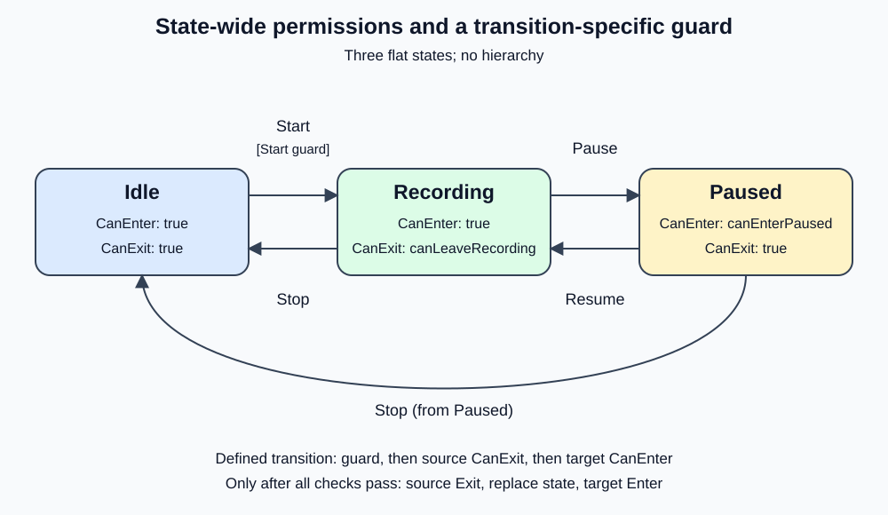

# 208000 - Recording with state permissions

This standalone .NET 10 exercise steps back from hierarchy and combines **state-wide permissions** with a **transition-specific guard**. Idle, Recording, and Paused are ordinary flat states: there is no RecordingSession parent. Earlier exercises remain unchanged.

## State diagram



## Three different scopes

| Condition | Where it lives | Meaning in this example |
|---|---|---|
| `canStartRecording` | Guard on the Idle + Start table row | Starting a new recording requires permission, such as available storage. Resume does not use this guard. |
| `canLeaveRecording` | `RecordingState.CanExit()` | Every departure from Recording requires permission, such as no write being pending. Both Pause and Stop use it. |
| `canEnterPaused` | `PausedState.CanEnter()` | Entering Paused requires permission, such as device support for pausing. |

Every state implements both `CanEnter()` and `CanExit()`. Unrestricted methods return `true`; they do not call an application policy. For example, Recording.CanEnter returns true, so denying the Start guard does not prevent Resume from entering Recording.

Paused has only one incoming transition in this small graph. Its CanEnter is nevertheless a state-wide rule: any future transition targeting Paused would automatically use it through the coordinator. By contrast, the Start guard is explicitly attached to just one transition row. A guard belongs to a source/request/target combination, not necessarily to every use of a trigger.

These policies are illustrative, not hardware implementations. In a real application, decide whether a rule really applies to every arrival/departure or just one transition. If Stop must remain available while Pause is denied, the condition should not be a shared Recording.CanExit rule.

## Execution order

For each request, `Recorder.TryHandle` performs:

1. Look up a transition using the current mode and request. If none exists, return `InvalidRequest` without checking permissions.
2. Evaluate the transition guard, if that row has one.
3. Evaluate the source state's `CanExit()`.
4. Evaluate the target state's `CanEnter()`.
5. Run source `Exit`, replace the active state, then run target `Enter`.

Checks stop at the first false result. Any denied guard or state permission returns `GuardDenied` with the source unchanged and no lifecycle hooks. `Transitioned` means every check and both hooks completed. Keeping the existing result enum makes this lesson about permission scope; it does not identify which condition denied the request.

| Transition | Application policy callbacks, in order | State permission methods that simply return true |
|---|---|---|
| Idle + Start -> Recording | Start guard | Idle.CanExit, Recording.CanEnter |
| Recording + Pause -> Paused | Recording.CanExit, Paused.CanEnter | None |
| Recording + Stop -> Idle | Recording.CanExit | Idle.CanEnter |
| Paused + Resume -> Recording | None | Paused.CanExit, Recording.CanEnter |
| Paused + Stop -> Idle | None | Paused.CanExit, Idle.CanEnter |

The console reports application policy calls, not methods that just return true. Therefore Resume prints only its lifecycle activity, even though the coordinator still checks its source and target permission methods. Initial Idle entry is initialization rather than a request-driven transition; it evaluates no permissions.

Compare this example with [203000](../203000_RecordingWithGuards/README.md): the Start-only rule is still a transition guard, while `CanEnter` and `CanExit` apply across all incoming or outgoing transitions for their state. The scopes are design choices, not a universal taxonomy; some state-machine libraries represent every restriction as a transition guard. See [205000](../205000_RecordingWithTransitionTable/README.md) for the earlier transition-table approach. The state factory switch only constructs objects; transition selection still lives in the table.

## Run

Open `RecordingWithStatePermissions.slnx`, or run from this exercise directory:

```powershell
dotnet run --project .\RecordingWithStatePermissions\RecordingWithStatePermissions.csproj
dotnet test .\RecordingWithStatePermissions.Tests\RecordingWithStatePermissions.Tests.csproj
dotnet test .\RecordingWithStatePermissions.slnx
```

Expected output:

```text
Enter Idle
Pause: InvalidRequest; state: Idle
Check Start guard
Start: GuardDenied; state: Idle
Start guard allowed.
Check Start guard
Exit Idle
Enter Recording
Start: Transitioned; state: Recording
Recording exit denied: both Pause and Stop are blocked.
Check Recording.CanExit
Pause: GuardDenied; state: Recording
Check Recording.CanExit
Stop: GuardDenied; state: Recording
Recording exit allowed; Paused entry denied.
Check Recording.CanExit
Check Paused.CanEnter
Pause: GuardDenied; state: Recording
Paused entry allowed.
Check Recording.CanExit
Check Paused.CanEnter
Exit Recording
Enter Paused
Pause: Transitioned; state: Paused
All policies now false: Resume does not use any of them.
Exit Paused
Enter Recording
Resume: Transitioned; state: Recording
Recording exit allowed again.
Check Recording.CanExit
Exit Recording
Enter Idle
Stop: Transitioned; state: Idle
```

## Tests and limits

The 36 deterministic MSTest cases have AAA comments and explanatory XML summaries. They cover all five accepted transitions, all seven undefined known pairs and unknown requests, exact policy/hook ordering and observed modes, guard denial/retry, exit denial on both outgoing Recording transitions, entry denial before source exit, short-circuiting, Resume with false or throwing unrelated policies, exception propagation/retry, nested-request rejection, lifecycle failures, null callbacks, and independent instances.

Permission methods answer whether an action is allowed; Enter and Exit perform lifecycle work. Checks should be side-effect-free, though the demo and tests record calls for observation. Checks do not reserve resources, enforce state invariants continuously, or provide concurrency safety. A condition changing while a state is active does not automatically exit that state.

This is synchronous, single-threaded teaching code with no hierarchy, parallel regions, asynchronous operations, or rollback. Permission exceptions leave the source selected and propagate. Lifecycle exceptions also propagate: failure during source Exit keeps the source; failure during target Enter keeps the selected target, even though entry did not complete. Nested requests from callbacks are rejected, and the processing flag is reset after failures.

Some state-machine libraries model all these restrictions as transition guards. State-wide CanEnter/CanExit is a useful design choice, not a universal taxonomy or a requirement of the State pattern.
