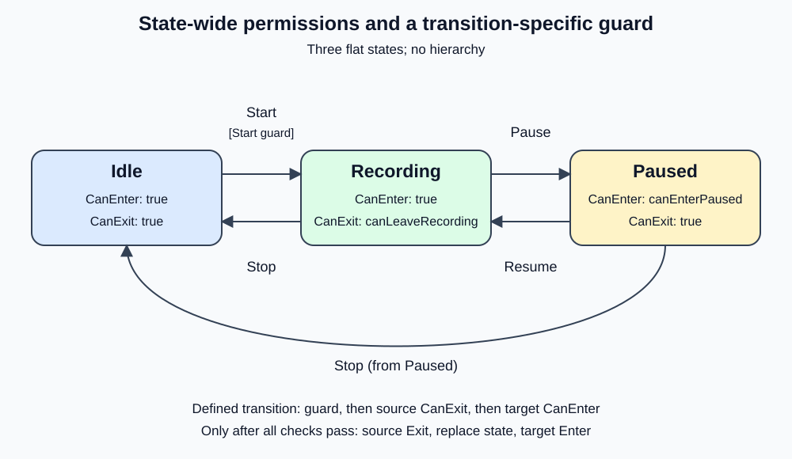

# 209000 - Recording with a base state

This standalone .NET 10 exercise repeats [208000's flat recorder](../208000_RecordingWithStatePermissions/README.md), but extracts repeated state behavior into an abstract `RecorderStateBase`. The five transitions, permission scope, lifecycle order, results, console output, and exception behavior stay the same. Earlier exercises remain unchanged.

## What the base class shares

```text
IRecorderState (contract)
	|
RecorderStateBase (shared implementation)
	+-- IdleState
	+-- RecordingState
	+-- PausedState
```

This is a **C# inheritance tree, not a state-machine hierarchy**. RecorderStateBase is never active, has no parent lifecycle, and contains no active child. Only one concrete state is active at a time.

| Member | Base implementation | Concrete responsibility |
|---|---|---|
| `Mode` | Abstract property, with no default | Every concrete state supplies its identity. |
| `CanEnter()` | Virtual, returns true | Paused overrides it with `canEnterPaused`. |
| `CanExit()` | Virtual, returns true | Recording overrides it with `canLeaveRecording`. |
| `Enter(reportActivity)` | Virtual, reports `Enter {Mode}` | Inherited by all three states. |
| `Exit(reportActivity)` | Virtual, reports `Exit {Mode}` | Inherited by all three states. |
| `DebuggerDisplay` | `{Mode.ToString(),nq}` on the base class | Inherited, showing just Idle, Recording, or Paused. |

IdleState now needs only its Mode override. RecordingState retains its exit-policy dependency and override; PausedState retains its entry-policy dependency and override. Unrestricted methods and identical lifecycle reporting are no longer repeated in each class.

The interface remains useful as the contract used by Recorder and StateFactory. The base class is an optional implementation of that contract, not a replacement for it. It is internal and abstract: callers cannot instantiate it, and all production states stay internal. A friend-assembly declaration permits focused tests of these internal defaults without making them public APIs.

## What stays in the recorder

Recorder still looks up a valid transition, checks the transition guard, source CanExit, and target CanEnter, and only then runs Exit, replaces the active state, and runs Enter. The transition table still owns valid source/request/target combinations and the Start-only guard flag. The base class does not dispatch requests or choose destinations.

- Idle + Start -> Recording checks the Start-only guard, then unrestricted state permissions.
- Recording + Pause -> Paused checks Recording.CanExit, then Paused.CanEnter.
- Recording + Stop -> Idle checks Recording.CanExit, then unrestricted Idle.CanEnter.
- Paused + Resume -> Recording and Paused + Stop -> Idle use only unrestricted state permissions.

Undefined pairs return InvalidRequest without checks. A false condition returns GuardDenied without lifecycle work. Permission callbacks are evaluated afresh. Initial Idle entry runs its inherited Enter hook without permission checks. See [section 21 of Discussion.md](../Discussion.md#21-sharing-state-behavior-with-a-base-class) for the design tradeoffs.

## State diagram



The transition diagram is unchanged from 208000 because code reuse does not change the graph.

## Run

Open `RecordingWithBaseState.slnx`, or run from this exercise directory:

```powershell
dotnet run --project .\RecordingWithBaseState\RecordingWithBaseState.csproj
dotnet test .\RecordingWithBaseState.Tests\RecordingWithBaseState.Tests.csproj
dotnet test .\RecordingWithBaseState.slnx
```

Expected output (identical to 208000):

```text
Enter Idle
Pause: InvalidRequest; state: Idle
Check Start guard
Start: GuardDenied; state: Idle
Start guard allowed.
Check Start guard
Exit Idle
Enter Recording
Start: Transitioned; state: Recording
Recording exit denied: both Pause and Stop are blocked.
Check Recording.CanExit
Pause: GuardDenied; state: Recording
Check Recording.CanExit
Stop: GuardDenied; state: Recording
Recording exit allowed; Paused entry denied.
Check Recording.CanExit
Check Paused.CanEnter
Pause: GuardDenied; state: Recording
Paused entry allowed.
Check Recording.CanExit
Check Paused.CanEnter
Exit Recording
Enter Paused
Pause: Transitioned; state: Paused
All policies now false: Resume does not use any of them.
Exit Paused
Enter Recording
Resume: Transitioned; state: Recording
Recording exit allowed again.
Check Recording.CanExit
Exit Recording
Enter Idle
Stop: Transitioned; state: Idle
```

## Tests and limits

The 36 recorder regression cases from 208000 are retained in this standalone project with AAA comments and explanatory summaries. Nine additional cases verify inherited default permissions and mode-based reporting, concrete permission overrides, virtual lifecycle extension through the interface, and inherited mode-only debugger metadata. Metadata tests do not automate the Visual Studio debugger UI.

Virtual hooks let a future state specialize entry or exit. An override must explicitly call `base.Enter` or `base.Exit` if it wants to retain the common report; base behavior is not automatically executed with an override. The test-only ExtendedState demonstrates this without adding domain behavior to the recorder. Default-allow permissions are a teaching policy, not a security boundary; applications needing explicit approval should choose stricter defaults.

This is a small code-reuse step, not a generic state framework. Shared inheritance reduces repetition but couples subclasses to base behavior, and C# permits only one class base. Use composition instead when behaviors vary independently. Keep transition coordination out of the base class and avoid adding speculative hooks.

The example remains synchronous and single-threaded, without hierarchy, parallel regions, asynchronous operations, or rollback. Permission exceptions leave the source selected. Exit failures retain the source; entry failures retain the already-selected target. Exceptions propagate, nested requests are rejected, and processing resets in a finally block. Permission checks do not reserve resources or continuously enforce invariants.
