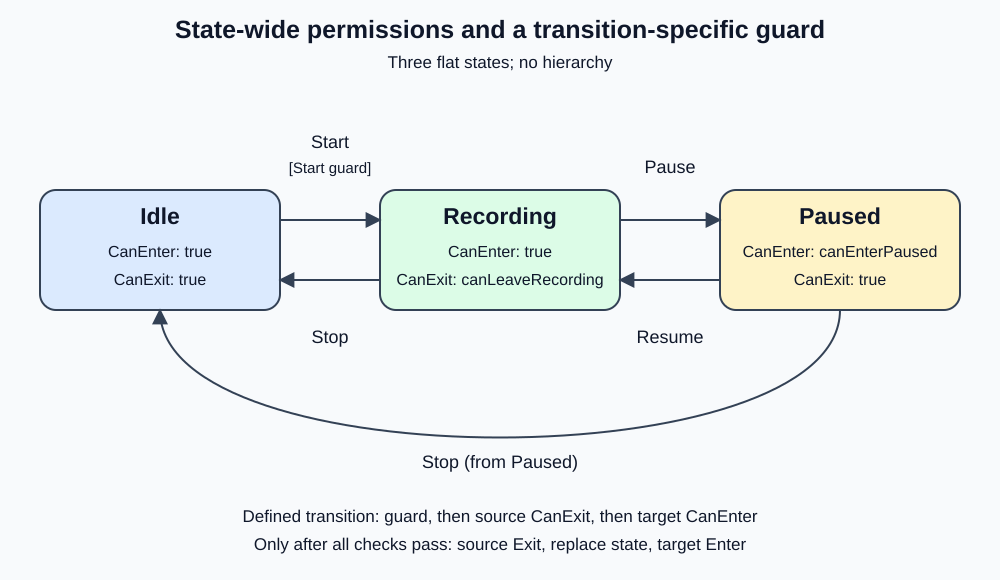

# 210000 - Recording with cached states

This standalone .NET 10 exercise builds on [209000's base-state recorder](../209000_RecordingWithBaseState/README.md) by caching one instance of each concrete state per `Recorder`. Revisiting a mode reuses its state object; transition behavior, permissions, lifecycle order, results, console output, and exception behavior remain unchanged. Earlier exercises remain unchanged.

## Shared state implementation

```text
IRecorderState (contract)
	|
RecorderStateBase (shared implementation)
	+-- IdleState
	+-- RecordingState
	+-- PausedState
```

This is a **C# inheritance tree, not a state-machine hierarchy**. `RecorderStateBase` is never active, has no parent lifecycle, and contains no active child. Only one concrete state is active at a time. This base-state design is carried forward from 209000; this lesson focuses on reusing the concrete objects.

| Member | Base implementation | Concrete responsibility |
|---|---|---|
| `Mode` | Abstract property, with no default | Every concrete state supplies its identity. |
| `CanEnter()` | Virtual, returns true | Paused overrides it with `canEnterPaused`. |
| `CanExit()` | Virtual, returns true | Recording overrides it with `canLeaveRecording`. |
| `Enter(reportActivity)` | Virtual, reports `Enter {Mode}` | Inherited by all three states. |
| `Exit(reportActivity)` | Virtual, reports `Exit {Mode}` | Inherited by all three states. |
| `DebuggerDisplay` | `{Mode.ToString(),nq}` on the base class | Inherited, showing just Idle, Recording, or Paused. |

IdleState now needs only its Mode override. RecordingState retains its exit-policy dependency and override; PausedState retains its entry-policy dependency and override. Unrestricted methods and identical lifecycle reporting are no longer repeated in each class.

The interface remains useful as the contract used by Recorder and StateFactory. The base class is an optional implementation of that contract, not a replacement for it. It is internal and abstract: callers cannot instantiate it, and all production states stay internal. A friend-assembly declaration permits focused tests of these internal defaults without making them public APIs.

## Reusing state instances

In 209000, `StateFactory.Create` constructs a new state object each time a transition selects a target. Here, `StateFactory` is an instance owned by one Recorder and holds a lazy cache. It creates Idle for initial entry, then creates Recording and Paused only when first requested. Later visits to those modes return the same objects. The Recorder still updates its active-state reference on each accepted transition.

These are **per-recorder cached instances**, sometimes called per-context singletons, not global singletons. Recording and Paused capture permission delegates supplied to a particular Recorder. A process-wide static state could bind to the wrong policy or leak behavior between independent recorders. Each Recorder therefore owns its own factory and state instances. The state objects have no active/inactive flag or transition history; the Recorder alone tracks which cached object is active.

Caching the object does not cache lifecycle or policy results. Each transition that passes its checks invokes source Exit, replaces the active-state reference, then invokes target Enter; each applicable CanEnter/CanExit policy is evaluated again. A throwing lifecycle callback may interrupt that sequence, with no rollback. Construction is separate from lifecycle entry: retrieving an already-cached state does not itself call Enter or Exit. The lazy cache reduces repeated state-object construction; it does not change the transition graph or behavior.

## What stays in the recorder

Recorder still looks up a valid transition, checks the transition guard, source CanExit, and target CanEnter, and only then runs Exit, replaces the active-state reference, and runs Enter. The transition table still owns valid source/request/target combinations and the Start-only guard flag. `RecorderStateBase` supplies shared state behavior but does not dispatch requests or choose destinations. `StateFactory` only returns the cached state object for a requested mode.

- Idle + Start -> Recording checks the Start-only guard, then unrestricted state permissions.
- Recording + Pause -> Paused checks Recording.CanExit, then Paused.CanEnter.
- Recording + Stop -> Idle checks Recording.CanExit, then unrestricted Idle.CanEnter.
- Paused + Resume -> Recording and Paused + Stop -> Idle use only unrestricted state permissions.

Undefined pairs return `InvalidRequest` without checks. A false condition returns `GuardDenied` without lifecycle work. Permission callbacks are evaluated afresh. Initial Idle entry runs its inherited Enter hook without permission checks. Compare with [209000](../209000_RecordingWithBaseState/README.md), where `StateFactory.Create` constructs a new state object for each target; this lesson changes only object reuse. The cache is safe here because state objects keep no per-activation data. If a state later acquires mutable activation data, provide an explicit reset lifecycle or construct a fresh instance instead.

## State diagram



The transition diagram is unchanged from 208000 and 209000: caching changes object construction and reuse, not the state graph.

## Run

Open `RecordingWithCachedStates.slnx`, or run from this exercise directory:

```powershell
dotnet run --project .\RecordingWithCachedStates\RecordingWithCachedStates.csproj
dotnet test .\RecordingWithCachedStates.Tests\RecordingWithCachedStates.Tests.csproj
dotnet test .\RecordingWithCachedStates.slnx
```

Expected output (identical to 208000):

```text
Enter Idle
Pause: InvalidRequest; state: Idle
Check Start guard
Start: GuardDenied; state: Idle
Start guard allowed.
Check Start guard
Exit Idle
Enter Recording
Start: Transitioned; state: Recording
Recording exit denied: both Pause and Stop are blocked.
Check Recording.CanExit
Pause: GuardDenied; state: Recording
Check Recording.CanExit
Stop: GuardDenied; state: Recording
Recording exit allowed; Paused entry denied.
Check Recording.CanExit
Check Paused.CanEnter
Pause: GuardDenied; state: Recording
Paused entry allowed.
Check Recording.CanExit
Check Paused.CanEnter
Exit Recording
Enter Paused
Pause: Transitioned; state: Paused
All policies now false: Resume does not use any of them.
Exit Paused
Enter Recording
Resume: Transitioned; state: Recording
Recording exit allowed again.
Check Recording.CanExit
Exit Recording
Enter Idle
Stop: Transitioned; state: Idle
```

## Tests and limits

The 36 recorder behavior cases from 208000 are retained with AAA comments and explanatory summaries. Nine tests cover the base-state behavior introduced in 209000. Five additional cases verify repeated factory lookups return the same reference for each mode, distinct factories keep their own instances and policies, and a Recorder reuses those same instances across multiple transitions while repeating permission checks and lifecycle hooks. Together the test project contains 50 cases. The tests inspect the factory owned by Recorder to verify identity; they do not automate the Visual Studio debugger UI.

State instances are reusable here because they contain only stable mode identity and recorder-scoped policy delegates; they do not store per-activation data. If a future state gains mutable data that should reset on each entry, define an explicit reset/activation contract or create a fresh object instead. The factory cache is not synchronized, matching the example's single-threaded recorder contract.

This is a small state-object reuse step, not a generic singleton framework. The shared base class still reduces repetition but couples subclasses to its behavior, and C# permits only one class base. Use composition when behaviors vary independently. Keep transition coordination in Recorder and do not cache active lifecycle progress or permission results.

The example remains synchronous and single-threaded, without hierarchy, parallel regions, asynchronous operations, or rollback. Permission exceptions leave the source selected. Exit failures retain the source; entry failures retain the already-selected target. Exceptions propagate, nested requests are rejected, and processing resets in a finally block. Permission checks do not reserve resources or continuously enforce invariants.
